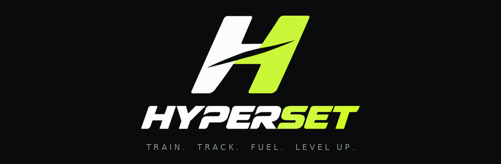
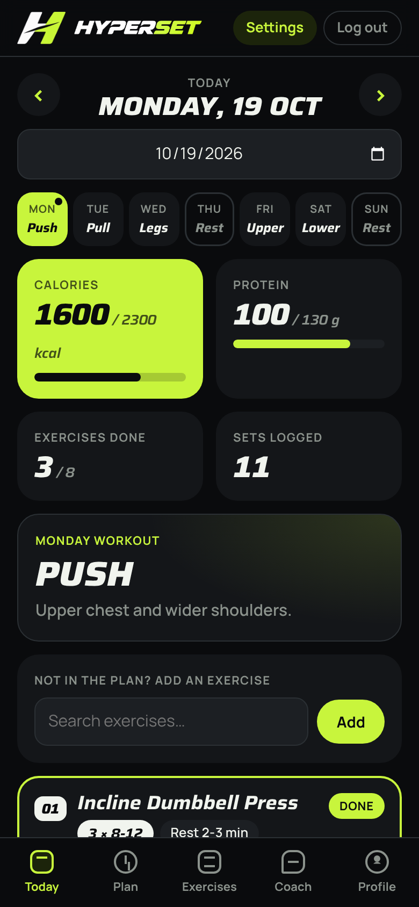
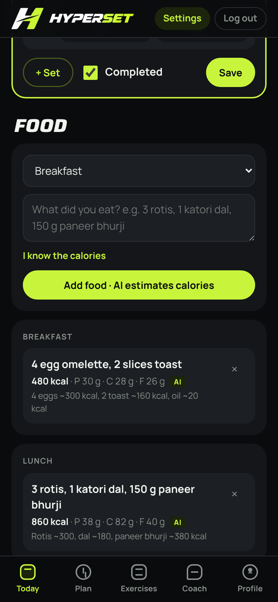
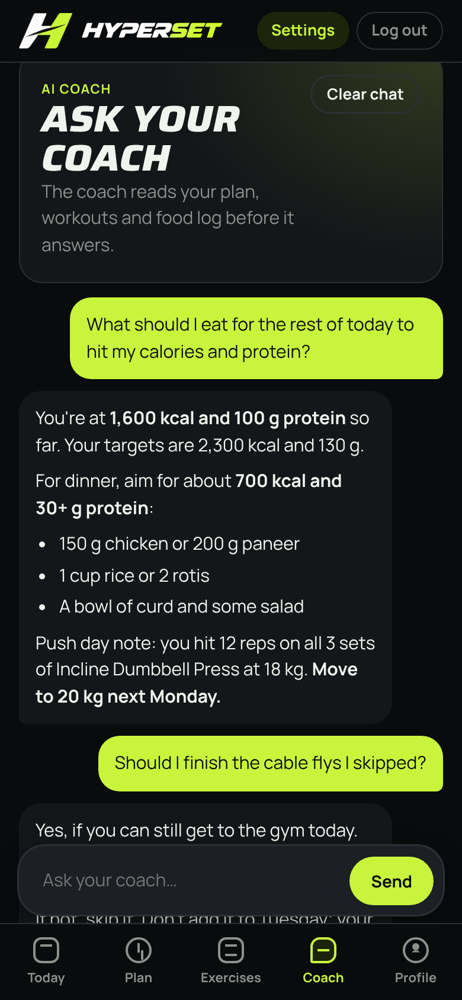
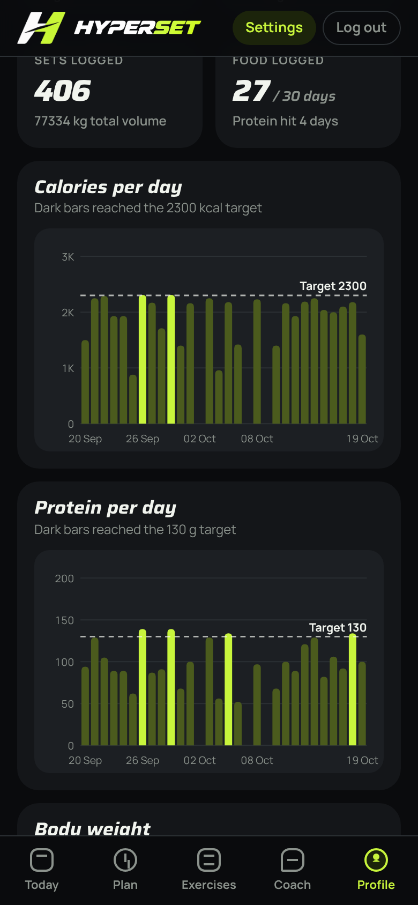
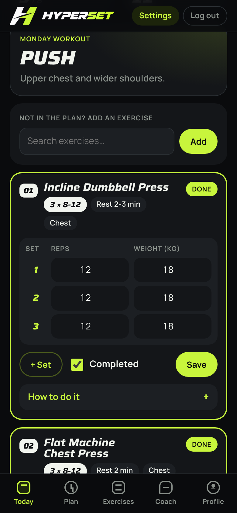
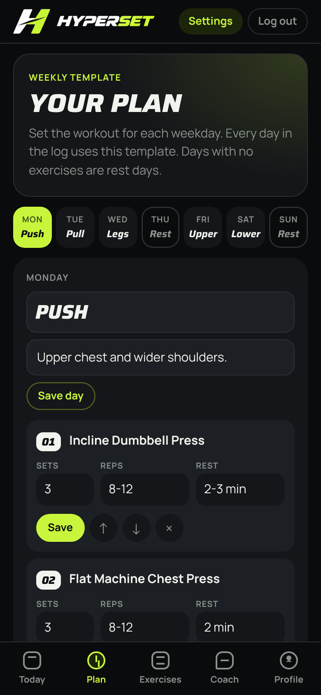
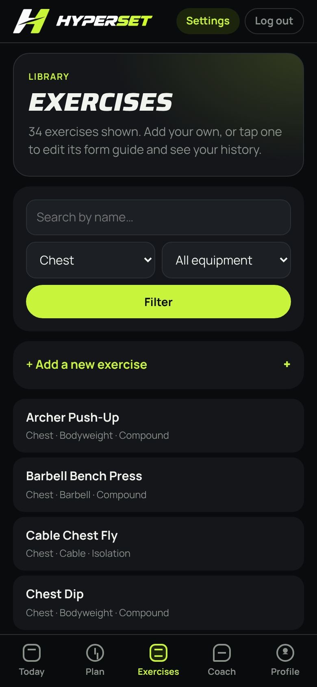
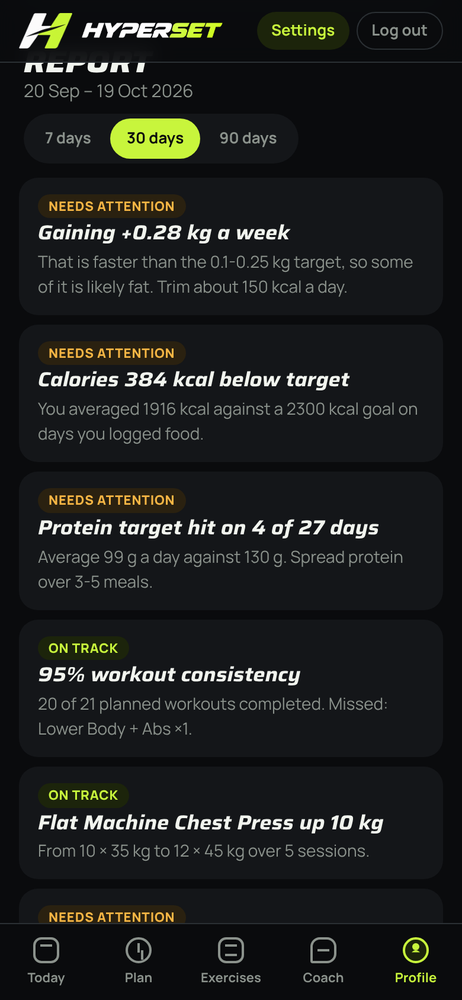
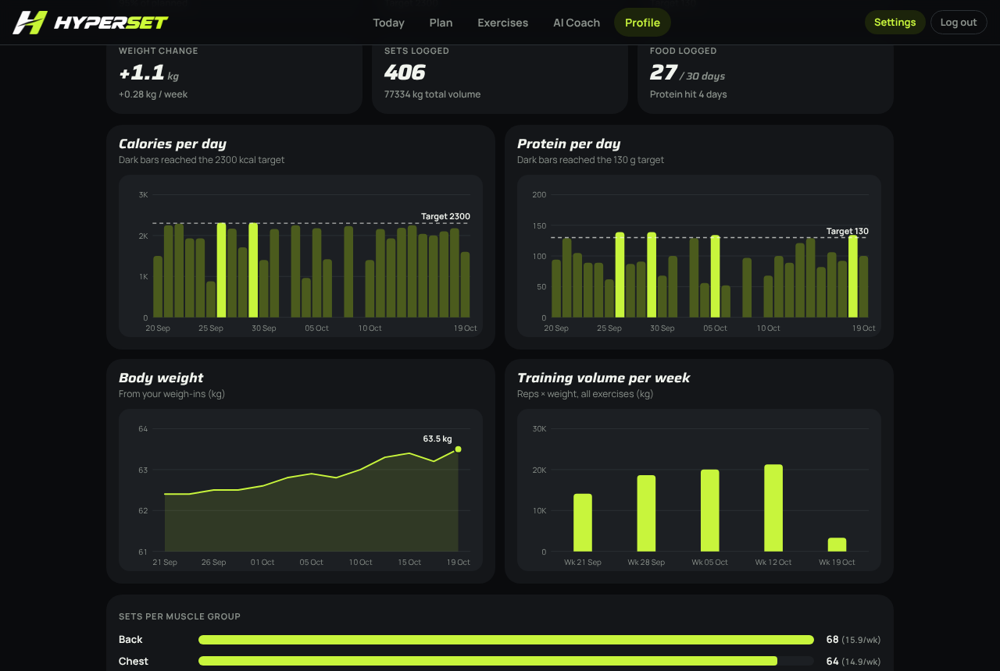

<p align="center">
  
</p>

<p align="center">
  <a href="https://github.com/saadchaudharry/hyperset/actions/workflows/tests.yml"></a>
  <a href="LICENSE"></a>
  
  
</p>

# HYPERSET

**Train. Track. Fuel. Level Up.** A self-hosted fitness app for workout tracking, nutrition and AI coaching.

Plan your training week, log every set and meal, and see whether you're actually gaining lean muscle. AI estimates the calories in what you ate, and an AI coach reads your logs to tell you what to do next.

It's built with Django and SQLite, plain HTML, CSS and JavaScript (no frontend framework), and Google's Gemini AI. It's mobile-first, installable on your phone's home screen, and runs anywhere Python does.

<p align="center">
  
  
  
  
</p>

## Features

- **Weekly plan.** Ships with a 5-day Push / Pull / Legs / Upper / Lower split that you can edit: days, exercises, sets, reps, rest and order.
- **Daily log.** Log reps and weight for each set, mark exercises complete, and add exercises that aren't in the plan.
- **AI calorie estimates.** Type "3 rotis, 1 katori dal" and get calories, protein, carbs and fat. Manual entry works too.
- **AI coach.** A chat that looks up your profile, plan, food, workouts and body weight through tool calls before answering.
- **Exercise library.** 353 exercises across every muscle group, cardio, plyometrics and mobility, with search, filters, form guides, your own exercises and per-exercise history.
- **Profile and report.** Body stats and targets, a weight and waist log, and a 7/30/90-day report with insights, charts, sets per muscle group and strength progress.
- **Accounts.** Login, logout and forgot password by email.
- **Easy configuration.** Set the Gemini API key and model in the Django admin, no restart needed.

## Quick start

```bash
git clone https://github.com/saadchaudharry/hyperset.git
cd hyperset
python -m venv .venv
source .venv/bin/activate        # Windows: .venv\Scripts\activate
pip install -r requirements.txt
python manage.py migrate
python manage.py createsuperuser
python manage.py runserver
```

Open http://127.0.0.1:8000, log in, then go to **Settings → AI settings** and paste your [Gemini API key](https://aistudio.google.com/apikey).

The full step-by-step guide for Windows, Mac and Linux is in [docs/setup.md](docs/setup.md).

## Documentation

| Guide | What's in it |
| --- | --- |
| [Setup](docs/setup.md) | Install, first login, Gemini key, profile, using it on your phone, troubleshooting |
| [User guide](docs/user-guide.md) | How to use every screen, with screenshots |
| [Configuration](docs/configuration.md) | Environment variables, AI settings, password reset emails |
| [Deployment](docs/deployment.md) | Railway, any Linux server, backups, updating |
| [Architecture](docs/architecture.md) | How it's built: request flow, data model, AI tool calls, report logic |
| [Screenshots](docs/screenshots.md) | Every screen on phone and desktop |
| [Brand](docs/brand.md) | Logo, colours, type, tagline and app icons |

## Screenshots

| Log your workout | Weekly plan | Exercise library | Insights |
| :---: | :---: | :---: | :---: |
|  |  |  |  |



[See all screenshots →](docs/screenshots.md)

## Tech stack

| Part | Choice |
| --- | --- |
| Backend | Django 5.2, SQLite |
| Frontend | Django templates, plain CSS and JavaScript, hand-drawn SVG charts, installable web app |
| AI | Google Gemini, with tool calling for the coach |
| Production server | gunicorn and WhiteNoise |

## Running the tests

```bash
python manage.py test tracker
```

Gemini is mocked, so no API key is needed. GitHub Actions runs the tests on every push and pull request.

## Contributing

Contributions are welcome. Read [CONTRIBUTING.md](CONTRIBUTING.md) for setup, code style and the pull request checklist. Please follow the [Code of Conduct](CODE_OF_CONDUCT.md). To report a security issue, see [SECURITY.md](SECURITY.md).

## Disclaimer

HYPERSET gives general fitness and nutrition guidance. AI calorie estimates are approximate, and the coach isn't a doctor or dietitian. Get professional advice for injuries, medical conditions or specific dietary needs.

## License

[MIT](LICENSE)
