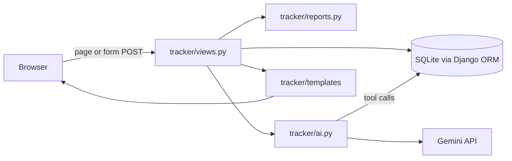
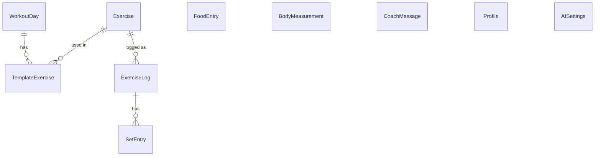

# Architecture

HYPERSET is a classic server-rendered Django app: one project (`config`) and one app (`tracker`). Pages are Django templates; plain JavaScript adds small touches such as extra set rows, the coach chat and SVG charts. There is no frontend build step.

## How a request flows

## Data model

| Model | Purpose |
| --- | --- |
| `Exercise` | Library entry: name, muscle group, equipment, category, instructions. |
| `WorkoutDay` | One weekday in the weekly template (title, focus). |
| `TemplateExercise` | An exercise planned on a weekday, with sets, reps, rest and order. |
| `ExerciseLog` | An exercise done on a date, with a completed flag. |
| `SetEntry` | One set of an `ExerciseLog`: reps and weight. |
| `FoodEntry` | Something eaten on a date, with calories, macros and AI notes. |
| `BodyMeasurement` | Weight and waist on a date. |
| `CoachMessage` | Chat history with the AI coach. |
| `Profile` | Single row: body stats, goal and daily targets. |
| `AISettings` | Single row: Gemini API key and model name. |

## AI features

Both live in `tracker/ai.py` and read the key and model from `AISettings` on every call.

- **Calorie estimate** (`estimate_food`): one prompt asking for JSON with calories, protein, carbs, fat and a short breakdown.
- **Coach** (`coach_reply`): a tool-calling loop. The model can call:
  - `get_profile_and_plan`: body stats, targets, weekly plan and recent weight/waist
  - `get_logs(start_date, end_date)`: food and workouts per day, up to 31 days
  - `get_exercise_history(exercise_name)`: recent sessions of one exercise

  The loop runs until the model answers without a tool call, for at most 6 rounds.

## Report and insights

`tracker/reports.py` builds the Profile report from the database: nutrition averages, workout consistency against the plan, weekly volume, sets per muscle group, strength progress (best set per session) and body-weight trend. `build_insights` turns these into plain-language findings with simple rules, for example a weekly gain above 0.25 kg is flagged as "Needs attention". No AI is used here.

## Files

| What | Where |
| --- | --- |
| Settings | `config/settings.py` |
| URLs | `config/urls.py`, `tracker/urls.py` |
| Models | `tracker/models.py` |
| Views | `tracker/views.py` |
| Forms | `tracker/forms.py` |
| AI | `tracker/ai.py` |
| Report and insights | `tracker/reports.py` |
| Seed data (exercise library, default plan) | `tracker/seed_data.py`, loaded by `migrations/0002_seed_data.py` |
| Templates | `tracker/templates/tracker/` (auth screens in `auth/`) |
| CSS and JavaScript | `tracker/static/tracker/style.css`, `app.js` |
| Logo, favicons, web app manifest | `tracker/static/tracker/brand/`, linked in `tracker/templates/tracker/_head.html` |
| Admin branding | `templates/admin/base_site.html` |
| Tests | `tracker/tests.py` |
