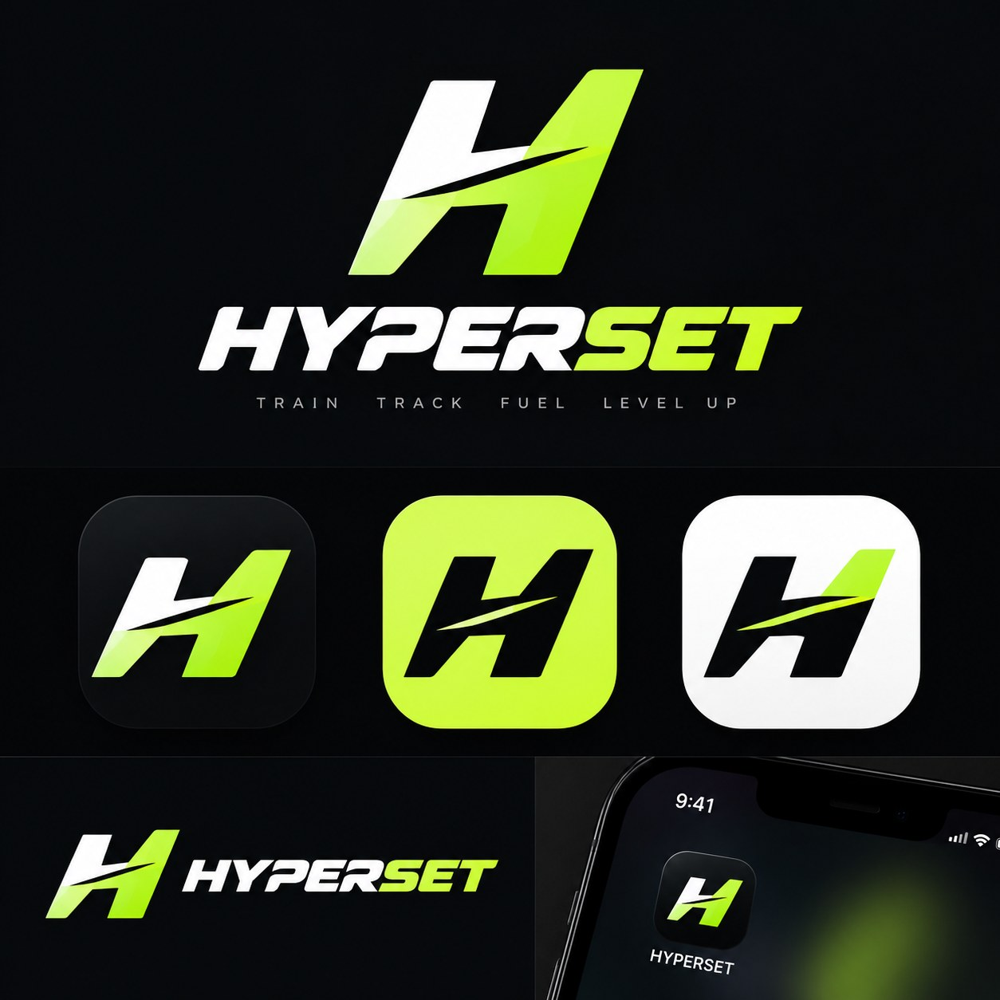
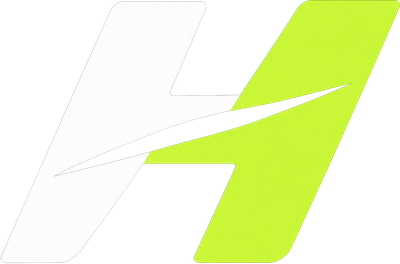
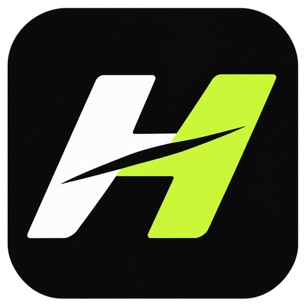

# HYPERSET brand

**Train. Track. Fuel. Level Up.**

HYPERSET is a fitness brand for a Gen Z audience: workout tracking, nutrition and AI coaching in one app. The identity uses a sharp, split **H**, bold italic type, and neon-lime accents on a matte-black background.

## Logo

| Asset | File | Use |
| --- | --- | --- |
| H mark | [`hyperset-mark.png`](brand/hyperset-mark.png) | Top bar, login screen, small spaces |
| Wordmark | [`hyperset-wordmark.png`](brand/hyperset-wordmark.png) | Next to the mark, headers |
| App icon | [`hyperset-icon.png`](brand/hyperset-icon.png) | Store listings, social avatars |
| Banner | [`hyperset-banner.png`](brand/hyperset-banner.png) | README, social cards |

  
  &nbsp;&nbsp;
  

- **The split H:** the left half is white and the right half is neon lime, cut by a diagonal slash that suggests speed.
- **The wordmark:** "HYPER" in white and "SET" in lime, heavy and italic.
- **Placement:** put the logo on matte black (`#0A0B0D`) or the dark tile colour. Leave space around it at least the height of the slash.
- **Don't** recolour the halves, stretch the mark, add outlines or shadows, or place it on busy photos.

## Colours

| Name | Hex | Use |
| --- | --- | --- |
| Matte black | `#0A0B0D` | Page background |
| Tile | `#141619` | Cards and panels |
| Surface | `#1C1F23` | Inputs and inner panels |
| Line | `#2B3034` | Borders and dividers |
| Neon lime | `#C8F53C` | Primary accent: buttons, active states, highlights, chart marks |
| Lime dim | `#4B5B1D` | Secondary chart marks, dashed borders |
| Lime tint | `#1C240B` | Tinted backgrounds behind lime text |
| Ink | `#F1F4EE` | Main text |
| Muted | `#8B928C` | Secondary text and labels |
| Warning | `#F5B544` | "Needs attention" |
| Error | `#FF6B5B` | Errors and destructive actions |

Text on lime is always matte black. Use lime for things you can act on or that need attention, not as a large background, except for one hero tile per screen (for example, the calories tile).

All colours are CSS variables at the top of [`tracker/static/tracker/style.css`](../tracker/static/tracker/style.css).

## Typography

| Role | Font | Style |
| --- | --- | --- |
| Display (headings, numbers, day names) | [Saira](https://fonts.google.com/specimen/Saira) | Italic, 700–800 weight, slightly expanded (112%); page titles in uppercase |
| Body (text, forms, buttons) | [Manrope](https://fonts.google.com/specimen/Manrope) | 400–800 weight |
| Labels | Manrope | 11px, bold, uppercase, wide letter-spacing |

## Tagline

**Train. Track. Fuel. Level Up.**

Set it in uppercase with wide letter-spacing under the wordmark, in muted grey.

## Voice

Short, direct and energetic, never preachy. Talk like a training partner: "Gaining +0.28 kg a week. Trim about 150 kcal a day." Use numbers and actions rather than hype.

## App icons and favicons

These live in `tracker/static/tracker/brand/` and are linked from every page in `tracker/templates/tracker/_head.html`:

| File | Size | Use |
| --- | --- | --- |
| `favicon.ico` | 48 × 48 | Browser tab (legacy) |
| `favicon-96x96.png` | 96 × 96 | Browser tab |
| `apple-touch-icon.png` | 180 × 180 | iPhone / iPad home screen |
| `web-app-manifest-192x192.png` | 192 × 192 | Android home screen |
| `web-app-manifest-512x512.png` | 512 × 512 | Android splash and install prompt |
| `site.webmanifest` | | App name, colours and icons for installing HYPERSET to the home screen |

To install it as an app, open HYPERSET on your phone, then choose **Add to Home Screen** (Safari share menu, or the Chrome menu).
