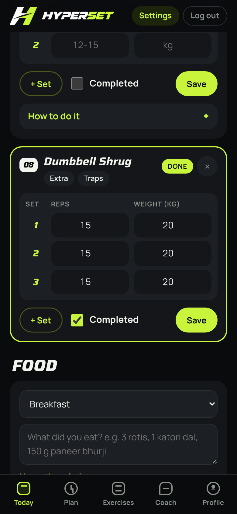
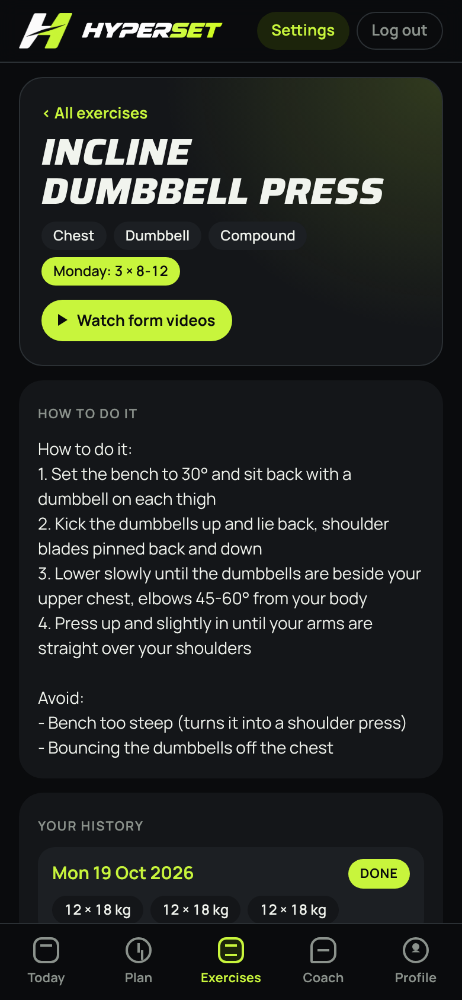
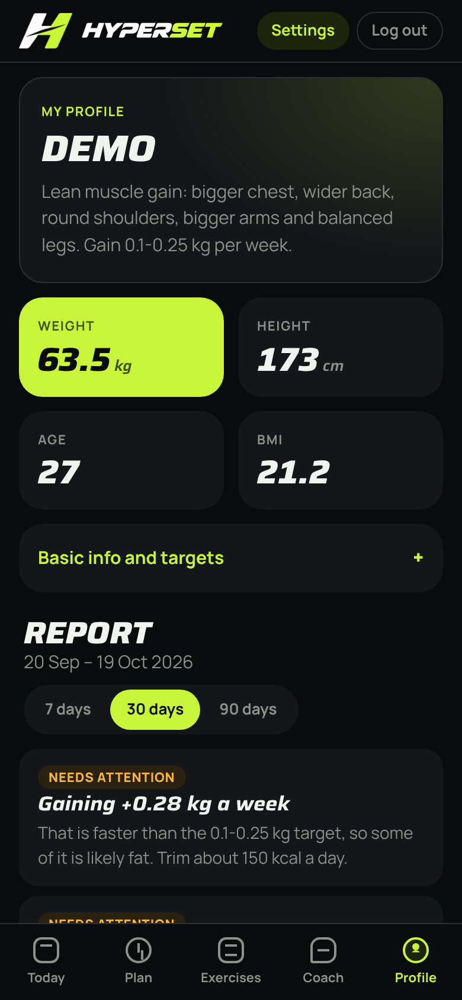
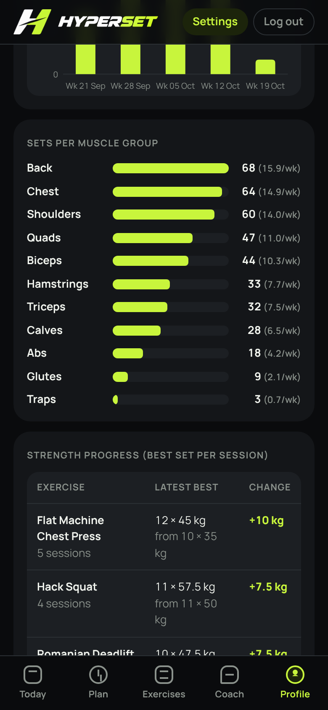
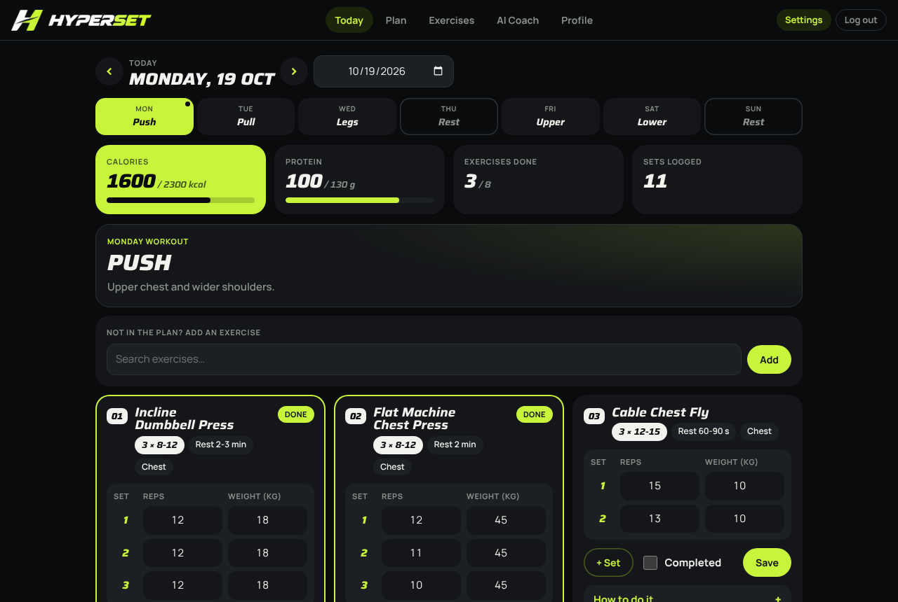

# Screenshots

All screens on a phone (390 × 844) and two on a desktop. The data shown is sample data.

| | | |
| :---: | :---: | :---: |
|  Login |  Forgot password |  Today |
|  Logging sets |  Extra exercise |  Food log |
|  Weekly plan |  Exercise library |  Exercise detail |
|  AI coach |  Profile |  Basic info and targets |
|  Insights |  Charts |  Muscle groups and strength |
|  AI settings (admin) | | |

## Desktop

