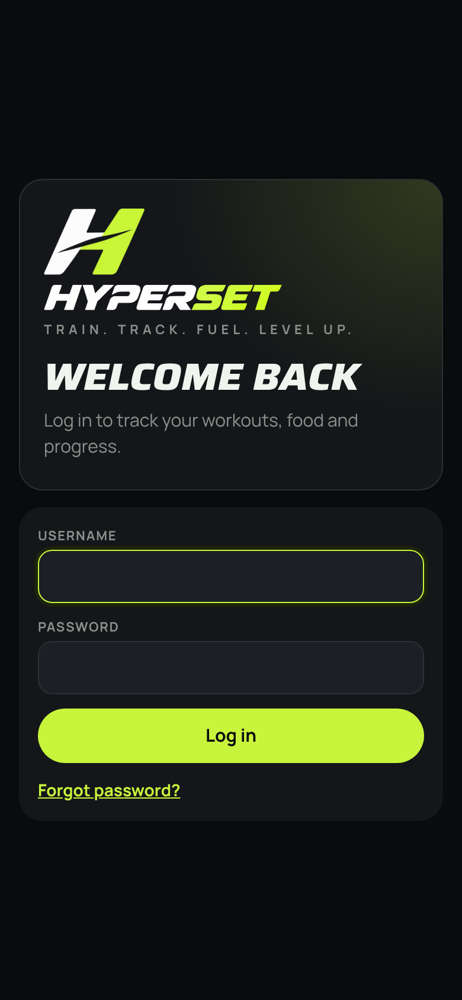
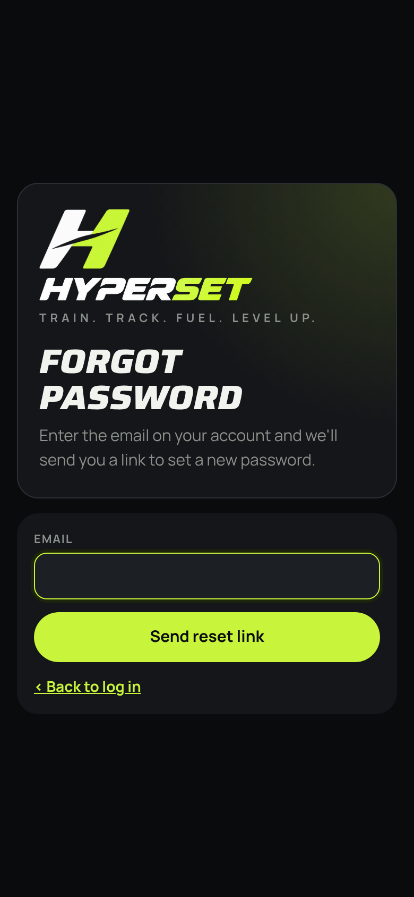
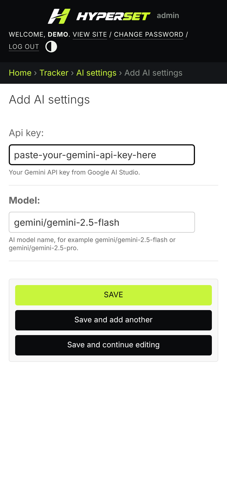
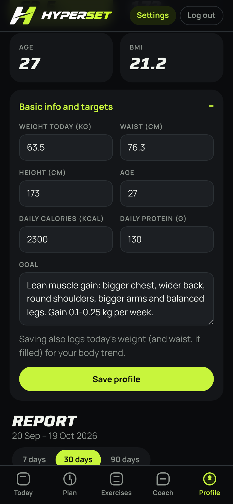

# Setup guide

This gets HYPERSET running on your own computer in about 5 minutes.

## 1. What you need

- **Python 3.11 or newer.** Check with `python --version` (Windows) or `python3 --version` (Mac / Linux). Get it from [python.org](https://www.python.org/downloads/). On Windows, tick **Add Python to PATH** during install.
- **Git** if you're cloning the repo, or just the downloaded zip.
- **A Gemini API key** for the AI features. It's free to start at [aistudio.google.com/apikey](https://aistudio.google.com/apikey). Everything else works without it.

## 2. Get the code

```bash
git clone https://github.com/saadchaudharry/hyperset.git
cd hyperset
```

Or unzip the download and open a terminal in the folder that contains `manage.py`.

## 3. Create a virtual environment and install packages

**Windows (Command Prompt or PowerShell)**

```bat
python -m venv .venv
.venv\Scripts\activate
pip install -r requirements.txt
```

**Mac / Linux**

```bash
python3 -m venv .venv
source .venv/bin/activate
pip install -r requirements.txt
```

`(.venv)` appears at the start of the terminal line when the environment is active. Activate it again every time you open a new terminal.

## 4. Create the database

```bash
python manage.py migrate
```

This creates `db.sqlite3` and loads the 353 built-in exercises and the default 5-day plan.

## 5. Create your login

```bash
python manage.py createsuperuser
```

Choose a username, enter **your real email** (forgot-password links go there) and a password.

## 6. Start the app

```bash
python manage.py runserver
```

Open **http://127.0.0.1:8000** and log in.

<p>
  
  
</p>

## 7. Add your Gemini API key

1. Click **Settings** in the top bar. This opens the Django admin.
2. Open **AI settings** and paste your key into **API key**.
3. Keep **Model** as `gemini/gemini-2.5-flash`, or use another Gemini model such as `gemini/gemini-2.5-pro`.
4. Click **Save**.



## 8. Set up your profile

Open the **Profile** tab, expand **Basic info and targets**, and fill in your weight, waist, height, age, goal, daily calories and daily protein. Saving also records today's weight for your body-weight chart.



You're ready. See the [user guide](user-guide.md) for how to use each screen.

## Use it on your phone (same Wi-Fi)

1. Start the server so other devices can reach it:
   ```bash
   python manage.py runserver 0.0.0.0:8000
   ```
2. Find your computer's IP: `ipconfig` on Windows (IPv4 Address), `ipconfig getifaddr en0` on Mac, `hostname -I` on Linux.
3. On your phone, open `http://<that IP>:8000`, for example `http://192.168.1.5:8000`.

If it doesn't load, allow Python through the computer's firewall.

## Troubleshooting

| Problem | Fix |
| --- | --- |
| `python` not found | Use `python3` (Mac / Linux), or reinstall Python with **Add to PATH** ticked (Windows). |
| `No module named django` | Activate the virtual environment first (step 3). |
| "Add your Gemini API key" message | Add the key in Settings → AI settings. |
| "AI request failed: No module named 'mcp'" | Your install has a different AI library version. In the project folder, with the virtual environment active, run `pip install -r requirements.txt` again, then restart `runserver`. |
| "AI request failed" | Check the key, that the model name starts with `gemini/`, and that you're online. |
| Port already in use | Run `python manage.py runserver 8001` and open port 8001. |
| Forgot password, no email set up | Run `python manage.py changepassword <username>`, or copy the reset link from the terminal (see [configuration](configuration.md#password-reset-emails)). |
| Start over with an empty database | Stop the server, delete `db.sqlite3`, then run `migrate` and `createsuperuser` again. |
